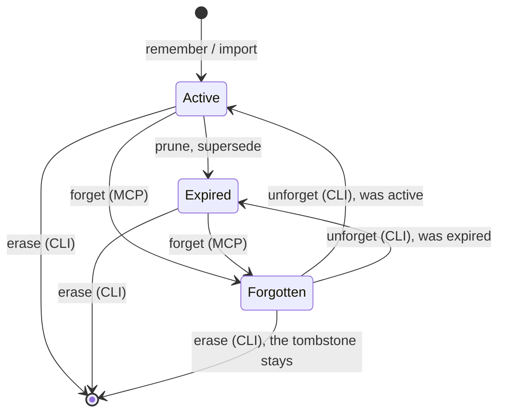

# feat(forgetting): make forget a reversible retraction behind a tombstone (#1023)

Branch `feat/1023-forget-retraction`, from `origin/main` 7a22c07 (v0.2.0-rc.1). Umbrella: dutiona/infra#37.
SQLite schema v15 → v16.

## Outcome

`forget(id, reason)` is the third model tool. Over HTTP, on a fact in the session's own bucket or at user level, it
ends the fact's validity (`t_expired`, `t_invalid`) and that of every active identical copy within the same Homes,
takes them out of every recall channel and writes a tombstone per fact keyed by the content hash, in one transaction;
the rows and every event stay. The tombstone keeps that exact content out of every import (both `bootstrap` paths,
`batch-ingest`, and #1026's backfill through the same chokepoint) and every derivation (wisdom promotion, the dream
cycle's outputs, conflict resolution, activity promotion). Only an explicit single assertion (`remember`, `add-fact`)
is never blocked. Two maintenance commands take the store lock or refuse: `memory-engine-cli unforget <id>` restores
the exact pre-forget state of that fact, and `memory-engine-cli erase --fact <id> | --machine <name>` is the store's
one hard delete. Erase records itself so every surviving `remember` call record stays linkable to what happened to
its fact, and it leaves no copy of the content it deletes in the live store's files.



## Constraints

From the issue (verbatim):

- Outcome: `forget(id, reason)` means "this fact won't come up again". The fact leaves recall and cannot return through promotion or re-import, yet an admin can reverse it.
- `forget(id, reason)` is registered as a model tool (completing ADR-0020's map), and over HTTP it:
  - ends the fact's validity in the bi-temporal model;
  - removes it from recall;
  - writes a tombstone that blocks promotion and re-import (re-running the ADR-0009 `--memory-dir` importer on its source leaves the fact absent);
  - keeps the fact row and raw events.
- Un-forget and erasure are `memory-engine-cli` maintenance commands that refuse to run while the server holds the store. Un-forget restores the fact to recall; erasure is the only operation that deletes, selecting by fact ID or by machine. By machine, it removes that machine's facts and events; dutiona/memory-engine#1025, dutiona/memory-engine#1026 and dutiona/memory-engine#1029 extend it to the tables they add (dutiona/infra#83 erases the smoke machine's data). Both refusals are tested.
- Owner, on #1020 / PR #1069: "a `remember`'s outcome is read from the fact side through `source_event_id`. An `erase` that deletes facts must keep each `remember`'s call record linkable to what happened to its fact (for example, keep the event and record the erasure), or the call log loses the outcome."

Contracts (they win over the issue text):

- ADR-0020 §8: `forget(id: integer, reason: string)`. "It answers `forgotten`, `already forgotten` or `not found`."
- ADR-0020 §8: "A response is a tool result whose first text content starts with the line `call ` followed by 16 lowercase hex digits." "The four tools return a failure as a tool result, never as a JSON-RPC error".
- ADR-0020 §8: "The server records each call: its ID, the machine, the tool, the time, and the IDs of the facts returned or changed."
- ADR-0020 §8: "**Write authority.** `forget` and `set_level` act only on a fact in the session's own project (or bucket) or at user level. A fact of another project, even one `recall` returned through its `project` argument, answers `not found`, which does not reveal that it exists." "**Pruning and deletion are never the agent's.**"
- ADR-0020 §8: "Pruning, erasure and reversing a forget are maintenance CLI operations, run with the unit stopped: `prune` (#1020), `erase` and `unforget` (#1023)." "'Refuses while the server holds the store' is one mechanism for both sides." It is `crates/memory-engine/src/store_lock.rs` (`StoreLock`) through `crates/memory-engine-cli/src/db.rs::open_engine_writable`.
- ADR-0021 §5: "**By-ID authority** (`forget`, `set_level`): a memory qualifies only when its Home is in the session's own candidate set {context Home, `user`}, never the `project` swap, and one of its Audiences matches. Otherwise the answer is `not found`, the same answer as for a missing ID". Case C17. Audiences do not exist yet (ADR-0021 stage 2).
- ADR-0021 §12: a call record is part of the ADR-0001 log (an appended event), never a table beside it.
- Spec decision 13 (owner): forget never deletes or prunes; pruning and true erasure are admin-only maintenance CLI with the unit stopped; no admin endpoint exists; backups keep older copies until restic retention rotates them (accepted).
- Until #1022 lands every session is keyless: context Home `unscoped:<machine>`, user level `user:<user>` (`crates/memory-engine-mcp/src/home.rs`).
- AGENTS.md: TDD; `thiserror`, no `unwrap()` in library code; rustdoc with `# Errors` and `# Examples` on public API items; frozen per-version SQLite migrations; the "Verify" matrix is the merge gate. This issue makes erasure the one exception to "soft deletion only" and to the append-only log.
- Postgres implements only `SchemaManager`: the new table gets a parity note on #634 (precedent: #1017), not Postgres code.
- The issue's "Likely files" are stale: `tools/definitions.rs` and `tools/handlers/p1.rs` no longer exist; the tools live in `crates/memory-engine-mcp/src/tools/{mod,recall,remember}.rs`.
- Public repository: repository-relative paths only, no host names, no timeline estimates.

## Decisions

Each line gives the decision and its reason. **Owner** marks a point Michaël settles by approving this plan.

- **D1 Tombstone.** One `fact_tombstones` row per forgotten fact, keyed for the gate by `content_hash` (`store/facts.rs::content_hash`, blake3, 32 hex characters; the DDL comment's `hex[:16]` is stale and frozen into `sqlite_master`, so it stays), computed from the row's content, never copied from its stored column. The match is store-wide and the row stores no text. Reason: a re-upload that #1026 files into another scope stays out, and erasure can keep the block without the content. **Owner:** identical text is blocked from imports in every scope, and a tombstone whose fact was erased has no command that lifts it.
- **D2 The gate fails closed.** `FactStore::insert` refuses tombstoned content (`ConflictError::Forgotten`). A new `FactStore::insert_asserted` is the only ungated insert and has one caller, `insert_fact_atomic`: the single explicit assertion (`remember`, `add-fact`, `add_fact`, `add_fact_precomputed`). `insert_or_reinforce` returns `ImportOutcome::{Created(i64), Reinforced(i64), Blocked}` and checks the tombstone on its create branch only, so an active twin is still reinforced. Reason: every other path, and any future one (#1025, #1026), is gated unless someone deliberately asserts; `remember` "never refuses". **Owner:** `batch-ingest` counts as an import, and conflict resolution as a derivation.
- **D3 Paths.** Verified on main:

  | Path | Reaches | Gate |
  |---|---|---|
  | `bootstrap --memory-dir`, `--jsonl-dir`, `bootstrap_session`, `bootstrap_directory` | `ingest_bootstrap_batch_atomic` → `insert_or_reinforce` | `Blocked`, counted in `BootstrapReport::facts_blocked` |
  | `add_facts_batch` | `insert_facts_batch_atomic` → `insert` | the atomic batch refuses whole: `Conflict(Forgotten)` |
  | `batch-ingest`, `add_facts_batch_partial` | the facade checks `Retraction::is_forgotten` per entry beside validation, before embedding; the valid rest goes through `insert_facts_batch_atomic` | that entry is a per-record `Err(Conflict(Forgotten))`, never embedded; the others land; the in-transaction gate stays the backstop |
  | wisdom promotion (`promote_with_lineage`) | `promote_atomic` → `insert` | refused: `Conflict(Forgotten)`, nothing written |
  | `apply_cycle_report`: `Promote`, `AddFact`, `Synthesize` | `apply_cycle_deltas_atomic` → `insert` | the delta is skipped and counted in `ApplyResult::blocked`; the other deltas apply |
  | conflict resolution Add and Update | `resolve_conflict_atomic` → `insert` | refused: `Conflict(Forgotten)` |
  | activity promotion (`engine/activity.rs::record_activity`) | `add_fact` | the facade asks `Retraction::is_forgotten` first and records the activity as `recorded` |
  | `remember`, `add-fact`, `add_fact`, `add_fact_precomputed` | `insert_fact_atomic` | ungated (`insert_asserted`) |
  | port `insert_fact` (conformance seeding, library) | `insert` | gated |
  | `import`, `restore_json`, `restore_sqlite` | raw `INSERT` or file copy into an empty store | not gated; they carry the snapshot's tombstones (item 9) |
  | port `insert_or_reinforce_fact` | no caller | deleted (item 2) |
- **D4 Forgetting an expired fact.** Inside the authority set, a fact that is expired but not forgotten answers `forgotten`: `t_expired = coalesce(t_expired, now)`, `t_invalid = min(coalesce(t_invalid, now), now)`, and the tombstone keeps both prior values. `unforget` writes them back exactly. `Restored { active }` is true only when the prior `t_expired` is NULL and the prior `t_invalid` is NULL or later than now (recall drops `t_invalid <= now`). Reason: dedup ignores expired rows, so without the tombstone a re-import would bring it back.
- **D5 Identical copies.** When the named fact becomes forgotten, every *active* fact with the same content in the authority set is retracted in the same transaction, each with its own tombstone row naming the same record. `unforget <id>`, given any of them, reverses that whole forget: every row whose tombstone names the same `record_event_id` (and, when an erase by machine has nulled that link, the named row alone). A copy remembered after the forget is a new assertion and stays. The facade therefore requires the record (`record: i64`). Reason: `remember` twice, or an import into both the bucket and the user level, leaves twins, and the session that forgot one would otherwise recall the other: "this fact won't come up again". **Owner:** the alternative is per-row forget, documented.
- **D6 Edges.** `forget` and `unforget` leave edges alone; `erase` deletes every incident edge (`EdgeStore::hard_delete_incident_to_facts`, not `hard_delete_by_facts`, which keeps boundary edges and would trip the FK). Reason: exact reversal, and no recall channel follows edges (`me-query`).
- **D7 Call record.** `forget` records first with detail `{"fact_id": id}`, the requested id, then acts; the tombstones it writes name the record (`record_event_id`), so the changed ids are read from the tombstone side and one forget's rows are found together, as a remembered fact's outcome is read through `source_event_id`. The reason, capture-cut to 512 bytes, lives in the tombstone rows only. Reason: `erase --fact` keeps events, and a reason that quotes the content must go with the erasure.
- **D8 Answers.** `forgotten`, `already forgotten` and `not found` are success results with exactly those words; argument and storage failures are `error:` results. `not found` is byte-identical for a missing id, a negative id, root and a fact outside the Homes. **Owner:** `not found` could instead be an error result; this plan reads ADR-0020's three answers as peers.
- **D9 Authority.** `home::own_homes(user, machine) -> Vec<String>` = `[bucket(machine), user_home(user)]` is the one function #1022 extends (a `Vec`, so adding the project changes no signature). The facade resolves the paths exactly (never a subtree; an unresolved path is dropped, and an empty set answers `NotFound` without a port call), and the port re-checks `scope_id IN homes` inside its transaction. Reason: no check-then-act race; `set_level` shares the set.
- **D10 Erase selection.** `--fact N` takes N and the activity that promoted it (its `args` and `result_summary` hold the content). `--machine M` (M validated as a lowercase DNS label, the machine-name grammar) takes the facts whose `metadata.machine = M` or whose scope is in the subtree of the `unscoped:M` bucket, the events whose top-level `payload.machine = M` (read through `CASE WHEN json_valid(payload)`) or whose scope is in that subtree, the facts whose `source_event_id` is one of those events, the activities whose scope is in that subtree, and the `session_checkpoints` whose `scope_path` is in it. Both then add every wisdom fact whose `lineage.source_fact_ids` names a taken fact (recursive), delete every summary whose `source_fact_ids` names one, set any other `activities.promoted_fact_id` naming one to NULL, and delete incident edges; `fact_vectors` and `lineage` cascade, `facts_fts_ad` fires. `--fact` deletes no event. The bucket's scope node stays. The report lists as `orphaned` the expired, untaken facts that a taken fact had replaced (the target of a `supersedes` or `contradicts` edge from a taken fact, the edge in any state, read before the incident edges are deleted, which covers a `Synthesize` result, a dream `Supersede` and a conflict Update): they stay expired. It lists as `copies` the untaken facts with the same content as a taken one, so an operator purging text can erase them too. Checkpoints are matched on `scope_path`, a rendering with no machine column: a checkpoint with a NULL path, or an activity of M's sessions filed outside the bucket, is not taken, and the docs say so. Reason: derived and capture rows carry the erased content. **Owner:** user-level facts stamped with M are M's and are erased; orphaned facts are reported, not restored.
- **D11 Erase leaves no copy in the live store.** Inside the transaction, FTS5 `optimize` (drops the deleted documents' tokens from old segments); after the commit, `VACUUM` then `PRAGMA wal_checkpoint(TRUNCATE)`, so neither free pages nor WAL frames keep earlier versions of the rows (a forget and every later update leave unzeroed copies that `secure_delete` would not reach); the HNSW sidecar is removed first and the next open rebuilds it. `VACUUM` takes time and up to about twice the store's size in free disk; the docs say so. The purge runs after the commit, so its failure is the port's one erase carve-out from "`Err` ⟹ unchanged": the rows are gone, and `EraseReport::purged` is false with its cause (a `VACUUM` error such as a full disk, or a checkpoint whose result row reports `busy`). The CLI then exits 1 with "erased, not purged: <cause>", and the retry is the same command: an erase whose target is already gone deletes nothing, appends no record, still purges, and reports the target not found (`erase --fact N` then exits 1 with "fact N not found; purged" or the purge error). The guarantee covers the rows erase deletes. A kept source event is outside it and is named in the record (`linked`); today's sources carry no content (`remember` records, bootstrap markers), and #1025 decides for its content-bearing lifecycle events. **Owner (accepted residuals):** erasure does not reach restic, the `<db>.vN.bak` migration backups, `.pak` archives, or a `-wal` left by a crash between the commit and the checkpoint.
- **D12 Tombstones survive erasure.** `fact_id` and `record_event_id` are `ON DELETE SET NULL`, and erase clears the reason and priors of the erased facts' rows. Erase never writes a tombstone. Reason: a forgotten fact must not come back after its erasure; an erased, never-forgotten fact can return through a source that still holds it (blocking is forget's job).
- **D13 Maintenance records.** `unforget` and `erase` append, in the operation's own transaction, a `SystemEvent` at the root scope, source `maintenance`, payload `{"op": "unforget", "fact_id", "forget_record"}` or `{"op": "erase", "target", "linked": [{"fact", "source_event"}], "orphaned": n, "copies": n, "deleted": {kind: count}}`, with no top-level `machine` key. `linked` lists each erased fact whose source event survives: that is the #1020 link; the orphaned and copy ids stay in the report only, so they never push the record toward the limit. An erase whose record would exceed the payload limit refuses as a whole (`Conflict(PayloadTooLarge)`); the docs say to erase by fact then. **Owner:** ADR-0021 §3 gains them as a third inert root writer (a one-line amendment, item 16).
- **D14 Port.** A seventh bounded trait, `Retraction` in `me-storage`, a supertrait of `StorageBackend`: forget, unforget, the tombstone read, `is_forgotten`, erase. Reason: one invariant and one conformance module; erase crosses facts, events, activities, checkpoints, summaries and lineage. No L3 crate: each operation is one port call (precedent: `pin_fact`).
- **D15 Machine names.** `machine_bucket(machine) -> String` and the lowercase-DNS-label check (`is_dns_label`, today in `crates/memory-engine-mcp/src/auth.rs`) move to `me-types` (`types::scope`); `home::bucket` and the auth parser delegate. Reason: erase, the CLI and the server cannot disagree about a bucket, and `a/b` cannot become a child of `unscoped:a`.
- **D16 Archive and export.** `list_archive_candidates` skips tombstoned facts (archival would hard-delete the kept row), and the JSON export and import carry `fact_tombstones` (`#[serde(default)]`), validated like edges, or a restored store loses every block and undo.
- **D17 Server guard.** `crates/memory-engine-mcp/clippy.toml` disallows `MemoryEngine::{forget, unforget_fact, erase, archive}` in server code, beside the derived-job guard; the `archive` entry sets `allow-invalid = true`, since the method exists only under the facade's `archive` feature, which the server crate alone does not enable. Reason: "pruning and deletion are never the agent's" holds at build time.
- **D18 Names.** Facade: `forget_fact`, `unforget_fact`, `erase`. The decay prune keeps `MemoryEngine::forget(&ForgetPolicy)`; its rename to `prune` (ADR-0020: "The word 'forget' passes to the retraction") spans `DreamCtx::forget` and goes to the follow-up list (item 18).
- **D19 No `--dry-run` on erase.** No consumer asks for one, the target is explicit, the report says what went, and backups are the owner's undo. Adding it later is additive.

How a forgotten fact is seen: recall's lexical and vector channels filter `TemporalFilter::Active` (`t_expired IS NULL`) during candidate generation and `assemble_results` drops `t_invalid <= now`, so it never takes a top-k slot. The HNSW index (feature `ann`, enabled by neither binary) gets `notify_expire` after the forget and `notify_insert` after an unforget that returns the fact to recall; without the latter the live index stays stale until the next open (the sidecar's HNSW is rebuilt from active rows at close). The in-memory graph holds active edges only and no fact state; forget does not change it, erase removes the erased facts' edges and nodes as `me_archive::archive` does. Residual: the opt-in archive recall fallback (`include_archives`, feature `archive`) ignores tombstones for an archived twin.

## Implementation sequence

Each item is one commit, written failing first. Commands run unpiped from the worktree root; a compile failure of a
new test against a missing API is the red step. Branch commits carry no co-author line.

- [x] 0. **Worktree.** `.worktrees/feat-1023-forget-retraction` on `feat/1023-forget-retraction` exists and is locked.

- [ ] 1. **`hard_delete_ids` binds one JSON array** (boy-scout; erase by machine needs it).
  - Files: `crates/me-backend-sqlite/src/store/facts.rs`.
  - Red: `hard_delete_ids_accepts_more_ids_than_sqlite_binds` (35,000 ids on an empty store → `Ok(0)`, mirroring `edges.rs::hard_delete_incident_to_facts_handles_large_id_set_without_param_limit`). `cargo test -p me-backend-sqlite --all-features --lib hard_delete_ids` fails with "too many SQL variables".
  - Change: `DELETE FROM facts WHERE id IN (SELECT value FROM json_each(?1))`.
  - Green: same command passes.
  - Commit: `fix(storage): bind hard_delete_ids as one JSON array, not one variable per id`

- [ ] 2. **Drop the uncalled port methods that bypass the gate or erase** (boy-scout): `insert_or_reinforce_fact` (an ungated second door to the import chokepoint), `hard_delete_facts` and `hard_delete_edges_by_facts` (hard deletes that skip erase's cleanup and record).
  - Files: `crates/me-storage/src/{graph.rs,backend.rs}`, `crates/me-backend-sqlite/src/sqlite/graph.rs`, the comments in `crates/memory-engine/src/engine/bootstrap.rs` that cite the first.
  - Red: none (dead code). `grep -rnE 'insert_or_reinforce_fact|hard_delete_facts|hard_delete_edges_by_facts' crates fuzz tests examples benches` lists only the trait methods, their impls and comments.
  - Green: `cargo build --workspace --all-features` succeeds and the same grep finds nothing.
  - Commit: `refactor(storage): drop three uncalled port methods`

- [ ] 3. **Archival unlinks `activities.promoted_fact_id` before it deletes** (boy-scout: archiving an expired activity-promoted fact aborts today, since the column has no `ON DELETE` and foreign keys are on).
  - Files: `crates/me-backend-sqlite/src/{store/activities.rs,sqlite/cold_storage.rs}`.
  - Red: `commit_archive_unlinks_a_promoting_activity` in `cold_storage.rs` fails with a foreign-key error.
  - Change: `ActivityStore::unlink_promoted_facts(&self, fact_ids: &[i64]) -> Result<usize>` (one `json_each` bind); `commit_archive_atomic` calls it before `hard_delete_ids`.
  - Green: `cargo test -p me-backend-sqlite --all-features --lib cold_storage` passes.
  - Commit: `fix(archive): unlink a promoting activity before archiving its fact`

- [ ] 4. **Schema v16: `fact_tombstones` and the child-key indexes erasure deletes through.**
  - Files: `crates/me-backend-sqlite/src/store/schema/{ddl.rs,migrations.rs,mod.rs,tests.rs}` and its snapshots.
  - Red, in `schema/tests.rs`: `simulate_v15` (fresh schema minus the v16 objects, `schema_version` 15); `migrate_v15_to_v16_adds_the_tombstone_table`; `migrate_v15_to_v16_is_idempotent_on_a_current_schema`; `fresh_vs_migrated_tombstones_converge` (normalized `sqlite_master.sql` equal for every v16 object); `a_tombstone_outlives_its_fact_and_its_record` (deleting both leaves the row and its hash, both links NULL). `cargo test -p me-backend-sqlite --all-features --lib store::schema` fails.
  - Change, the DDL (in `TABLES_DDL`/`INDEXES_DDL`, and as a frozen copy in `migrate_v15_to_v16`):

    ```sql
    CREATE TABLE IF NOT EXISTS fact_tombstones (
        id              INTEGER PRIMARY KEY,
        fact_id         INTEGER UNIQUE REFERENCES facts(id) ON DELETE SET NULL,
        content_hash    TEXT    NOT NULL,
        reason          TEXT,
        forgotten_at    TEXT    NOT NULL,
        record_event_id INTEGER REFERENCES events(id) ON DELETE SET NULL,
        prior_t_expired TEXT,
        prior_t_invalid TEXT
    );
    CREATE INDEX IF NOT EXISTS idx_fact_tombstones_hash ON fact_tombstones(content_hash);
    CREATE INDEX IF NOT EXISTS idx_fact_tombstones_record ON fact_tombstones(record_event_id);
    CREATE INDEX IF NOT EXISTS idx_facts_source_event ON facts(source_event_id);
    CREATE INDEX IF NOT EXISTS idx_activities_promoted ON activities(promoted_fact_id);
    ```

    `MIGRATIONS` gains `(migrations::migrate_v15_to_v16, false)`; `CURRENT_SCHEMA_VERSION = 16`; tests and docs that hard-code 15 as current follow; regenerate goldens with `INSTA_UPDATE=always` and read the diff. On a rebase over #1021's migration: rename to the next version, append after its entry, bump once more; every statement is `IF NOT EXISTS`, so nothing else changes.
  - Green: `cargo test -p me-backend-sqlite --all-features --lib` and `cargo test -p memory-engine-cli --all-features` (stale-store fixtures re-run the step) pass.
  - Commit: `feat(storage): schema v16 adds fact_tombstones`

- [ ] 5. **The `Retraction` port: forget, unforget, the tombstone read and `is_forgotten`.**
  - Files: `crates/me-types/src/types/{retraction.rs (new),mod.rs}`; `crates/me-storage/src/{retraction.rs (new),lib.rs,backend.rs}`; `crates/me-backend-sqlite/src/store/{tombstones.rs (new),mod.rs,facts.rs}`, `crates/me-backend-sqlite/src/sqlite/{retraction.rs (new),mod.rs,search_index.rs}`; `crates/me-test-support/src/{retraction.rs (new),lib.rs,read_only.rs}`; `crates/memory-engine/src/storage/mod.rs`.
  - Red: conformance cases in `me-test-support/src/retraction.rs`, generic over `ConformanceBackend`, seeded through the port, registered in `all_behaviors_into!`: `forget_is_not_found_outside_its_homes` (missing id, a scope outside `homes`, empty `homes`, a forgotten fact outside `homes`); `forget_ends_validity_and_writes_the_tombstone`; `forget_retracts_active_copies_in_its_homes_only` (a bucket twin and a user twin retracted, desktop's twin and an already expired twin untouched); `forget_twice_is_already_forgotten` (reason and time unchanged); `forget_of_an_expired_fact_keeps_its_history` (D4); `a_forgotten_fact_leaves_lexical_and_vector_search`; `unforget_restores_the_prior_state_and_records_it` (raw column strings equal; one `unforget` record); `unforget_reverses_the_whole_forget` (given a copy's id, every row of that forget returns; an erased copy's tombstone stays; a later, separate forget of other content is untouched); `unforget_reports_active_only_when_recall_would_show_it` (a past prior `t_invalid` → `active: false`); `unforget_of_a_live_or_missing_fact`; `is_forgotten_matches_content_in_any_scope`; `write_rejected_reads_succeed` gains both writes. In `search_index.rs` (B4, `ann`): `forget_and_unforget_keep_the_hnsw_index_in_step` (query nearest the fact, `limit` 1, so the brute-force fallback cannot mask a stale index). `cargo test -p me-test-support --all-features retraction` does not compile.
  - Change:
    - `me-types`: `enum ForgetOutcome { Forgotten, AlreadyForgotten, NotFound }`; `enum UnforgetOutcome { Restored { facts: Vec<(i64, bool)> }, NotForgotten, NotFound }` (each restored id with whether recall shows it again); `struct Tombstone { fact_id: Option<i64>, content_hash: String, reason: Option<String>, forgotten_at: DateTime<Utc>, record_event_id: Option<i64>, prior_t_expired: Option<DateTime<Utc>>, prior_t_invalid: Option<DateTime<Utc>> }` (serde).
    - `me-storage`: `#[async_trait] pub trait Retraction: Send + Sync` with `forget_fact(&self, id: i64, homes: &[i64], reason: &str, record: i64, now: DateTime<Utc>) -> Result<ForgetOutcome>`, `unforget_fact(&self, id: i64, now: DateTime<Utc>) -> Result<UnforgetOutcome>`, `tombstone(&self, fact_id: i64) -> Result<Option<Tombstone>>`, `is_forgotten(&self, content: &str) -> Result<bool>`. Contract: `Ok` ⟹ committed, `Err` ⟹ store unchanged, except unforget's post-commit `IndexInconsistent`; empty `homes` means no scope. `StorageBackend` and its blanket impl gain `+ Retraction`, with `_assert_retraction_obj_safe` and the coverage checklist line.
    - SQLite, one write transaction each. Forget: the fact with `scope_id IN json_each(homes)` (none → `NotFound`); a tombstone naming it → `AlreadyForgotten`; else, for it and its active same-content facts in `homes` (matched on `content = ?` within `scope_id IN homes AND t_expired IS NULL`, never on the stored hash column, which a restore copies verbatim), insert a tombstone and apply D4 → `Forgotten`; post-commit `hnsw_notify_expire` for each that was active. Unforget: a tombstone names it → for every row of the same forget (D5) whose fact still exists (`fact_id IS NOT NULL`, so an erased copy's permanent block stays), restore both priors and delete the tombstone, append D13's record → `Restored` with D4's `active` per fact, post-commit `hnsw_notify_insert` with the embeddings read inside the transaction for the active ones; the fact exists without one → `NotForgotten`; else `NotFound`. `store/tombstones.rs` holds `blocks(conn, content) -> Result<bool>`, the row reads and writes, and `append_maintenance(tx, payload, now)`.
  - Green: `cargo test -p me-test-support --all-features` (the postgres arm stays ignored), `cargo test -p me-storage --all-features` and `cargo test -p me-backend-sqlite --all-features --lib` pass.
  - Commit: `feat(storage): forget and unforget a fact behind a tombstone`

- [ ] 6. **The facade's `forget_fact` and `unforget_fact`, and `explain` names a forget.**
  - Files: `crates/memory-engine/src/engine/{retraction.rs (new),mod.rs,inspect.rs}`, `crates/memory-engine/src/inspect/types.rs`, `crates/memory-engine/src/lib.rs`, `tests/retraction_test.rs` (new, with its `[[test]]` entry in `crates/memory-engine/Cargo.toml`, where `autotests = false`).
  - Red, in `tests/retraction_test.rs`: `forget_fact_resolves_homes_exactly` (a parent path and an unknown path → `NotFound`); `a_forgotten_fact_leaves_every_read_path` (`execute_query` with text, embedding, both and neither over `scope_exact_set`; `list_active_facts`; `resume_context`; `list_due`; again after `close()` and a reopen); `unforget_returns_the_fact_to_text_and_vector_recall` (before and after a reopen); `explain_names_a_forget`; `a_read_only_engine_refuses_forget_and_unforget`. A doctest on `forget_fact`: `Forgotten`, `AlreadyForgotten`, then `NotFound` for a foreign Home. `cargo test -p memory-engine --all-features --test retraction_test` does not compile.
  - Change: `pub async fn forget_fact(&self, id: i64, homes: &[String], reason: &str, record: i64) -> Result<ForgetOutcome>` (`ensure_writable`, `check_str_size(reason, "forget reason")`, exact resolution per D9, then the port with `Utc::now()`); `pub async fn unforget_fact(&self, id: i64) -> Result<UnforgetOutcome>`; both with `# Errors` and `# Examples`. `ExpiredReason::Forgotten` becomes `Forgotten { at: DateTime<Utc>, reason: Option<String>, record_event_id: Option<i64> }`; `explain_fact` asks `tombstone` before `determine_state`; the enum doc says a forget is reported exactly and the other reasons best-effort.
  - Green: same command, `cargo test -p memory-engine --all-features` and `cargo test -p memory-engine --all-features --doc forget_fact` pass; the run reports a non-zero count for `retraction_test`.
  - Commit: `feat(engine): forget_fact and unforget_fact, and explain names a forget`

- [ ] 7. **The gate keeps forgotten content out of import and batch writes.**
  - Files: `crates/me-types/src/error.rs` (`ConflictError::Forgotten`); `crates/me-storage/src/graph.rs` (`ImportOutcome`, `BootstrapIngestOutcome::Ingested(Vec<ImportOutcome>)`); `crates/me-backend-sqlite/src/store/facts.rs`, `crates/me-backend-sqlite/src/sqlite/graph.rs`; `crates/memory-engine/src/{engine/bootstrap.rs,bootstrap/metrics.rs,storage/mod.rs}` and the two `BootstrapReport` snapshots; `crates/memory-engine-cli/src/commands/bootstrap.rs`; `tests/retraction_test.rs`.
  - Red: `facts.rs`: `insert_refuses_forgotten_content_and_insert_asserted_does_not`; `insert_or_reinforce_blocks_only_the_create_branch` (same scope and another scope → `Blocked`, no row; an active twin → `Reinforced`; other content → `Created`). `sqlite/graph.rs`: `ingest_bootstrap_batch_reports_blocked_facts` (marker and marker-less paths); `batch_and_conflict_inserts_refuse_forgotten_content` (atomic batch refused whole, both conflict arms refused); `insert_fact_atomic_accepts_forgotten_content`. `tests/retraction_test.rs`: `a_partial_batch_fails_only_its_forgotten_entry` (that record is `Err(Conflict(Forgotten))` and was never embedded, the others land); `re_importing_a_memory_dir_leaves_a_forgotten_fact_out` (import into `user:alice`, forget, rerun into `user:alice` and into `unscoped:laptop`: `facts_blocked == 1`, `facts_created == 0`; after `unforget_fact` a rerun reinforces); `re_bootstrapping_a_session_leaves_a_forgotten_fact_out` (`skip_existing: false`). CLI unit: `a_rerun_over_a_forgotten_memory_reports_it_blocked`; CLI binary (`tests/cli_integration.rs`): `batch_ingest_skips_a_forgotten_line_and_lands_its_chunk`. `cargo test -p me-backend-sqlite --all-features --lib forgotten_content` fails.
  - Change: `insert` checks `tombstones::blocks` and calls a private `insert_row`; `insert_asserted` calls `insert_row` and its doc cites ADR-0020 §8; only `insert_fact_atomic` switches to it; `me-ingest::add_facts_batch_partial` checks `is_forgotten` per entry beside `validate_add_fact_request`; `insert_or_reinforce -> Result<ImportOutcome>`; the batch transaction stamps the identity only when one outcome is `Created`; `BootstrapReport::facts_blocked` (and `merge`); both facade accounting sites match three outcomes; the `# Errors` of every public method that can now refuse forgotten content say so (`add_facts_batch(_partial)` in `engine/ingest.rs` and `me-ingest`, `resolve_conflict` in `engine/conflict.rs` and `me-resolve`, `FactGraph::insert_fact`, and in item 8 `CycleCtx::promote` in `me-traits`); the CLI prints `facts blocked:` and appends ` facts_blocked=N` at the end of the plain line, so key=value parsers keep working.
  - Green: `cargo test -p me-backend-sqlite --all-features`, `cargo test -p memory-engine --all-features` and `cargo test -p memory-engine-cli --all-features bootstrap` pass; each snapshot diff adds one `facts_blocked` line.
  - Commit: `feat(storage): a forget's tombstone keeps its content out of import`

- [ ] 8. **The gate keeps forgotten content out of promotion.**
  - Files: `crates/me-types/src/types/cycle_report.rs` (`ApplyResult::blocked`, `#[serde(default)]`); `crates/me-backend-sqlite/src/sqlite/consolidation.rs`; `crates/me-storage/src/consolidation.rs` (docs); `crates/memory-engine/src/engine/activity.rs`.
  - Red: `promote_atomic_refuses_forgotten_content` (`Conflict(Forgotten)`, no fact, no lineage); `apply_cycle_deltas_skip_forgotten_content` (`Promote` of an active twin, an `AddFact` and a `Synthesize` with forgotten content: `blocked == 3`, no new fact, the synthesize's sources still active, the other deltas applied; `Promote` of the forgotten fact itself stays `Cycle(AlreadyExpired)`); `a_forgotten_activity_promotion_is_recorded_not_promoted`. `cargo test -p me-backend-sqlite --all-features --lib forgotten` fails.
  - Change: `promote_atomic` refuses inside its transaction; the three apply arms check `tombstones::blocks` before `insert`, skip and count; `record_activity` asks `is_forgotten(&action.fact_content)` before `add_fact`, with a comment that the check reads outside the write and that `record_activity` has no server or CLI caller.
  - Green: `cargo test --workspace --all-features forgotten` passes.
  - Commit: `feat(cognitive): a forget's tombstone keeps its content out of promotion`

- [ ] 9. **Archival leaves forgotten facts, and export and import carry tombstones.**
  - Files: `crates/me-backend-sqlite/src/{store/facts.rs,inspect/dump.rs,store/tombstones.rs}`; `crates/me-types/src/types/inspect.rs` (`EngineSnapshot::tombstones`, `#[serde(default)]`); `crates/memory-engine/src/inspect/{restore.rs,types.rs}` and the `snapshot_populated_engine_dump` snapshot; `tests/archive_test.rs`, `tests/restore_roundtrip_test.rs`.
  - Red: `archive_leaves_a_forgotten_fact_in_place` (forget, archive with `expired_before` after it: the row stays, `unforget_fact` restores it); `export_and_import_carry_tombstones` (restore into a new path: `explain` says forgotten, a memory-dir rerun is blocked, `unforget_fact` works); `a_snapshot_with_a_dangling_tombstone_is_refused_before_any_write` (a `fact_id` or `record_event_id` the snapshot lacks, a hash that is not 32 hex characters); `engine_snapshot_tombstones_default_when_absent`. `cargo test -p memory-engine --all-features --test archive_test --test restore_roundtrip_test` fails.
  - Change: `list_archive_candidates` adds `AND id NOT IN (SELECT fact_id FROM fact_tombstones WHERE fact_id IS NOT NULL)`; the dump streams `tombstones` after `fact_vectors`; `validate_snapshot` checks them as it checks edges; restore inserts them after facts and events; `assert_empty_db` counts the table; every `EngineSnapshot` literal gains the field.
  - Green: same command, then `cargo test -p memory-engine --all-features` with the dump snapshot re-recorded (`tombstones: []`).
  - Commit: `feat(storage): archival and export keep a forget`

- [ ] 10. **Erase, in one store transaction.**
  - Files: `crates/me-types/src/types/{retraction.rs,scope.rs,mod.rs}`; `crates/me-storage/src/retraction.rs`; `crates/me-backend-sqlite/src/{sqlite/retraction.rs,store/tombstones.rs,store/events.rs,store/activities.rs,store/checkpoints.rs}`; `crates/me-test-support/src/{retraction.rs,read_only.rs}`; `crates/memory-engine-mcp/src/{home.rs,auth.rs}`.
  - Red, conformance cases: `erase_fact_clears_every_reference` (target A with edges A→B, B→A, A→W, a vector, a promoting activity, a summary naming A, a wisdom fact W whose lineage names A, a tombstone: afterwards A, W, the activity and the summary are gone, B and its other edges stay, the tombstone keeps its hash with link, reason and priors NULL, an FTS match on A's word finds nothing); `erase_fact_keeps_its_source_event_and_links_it` (the record's `linked` is `[{fact: A, source_event: E}]`, no top-level `machine`); `erase_reports_orphans_and_copies` (a `Synthesize` result's expired sources and a conflict Update's predecessor are `orphaned`; an untaken twin is in `copies`); `erase_machine_takes_what_names_it_or_sits_in_its_bucket` (a fact in the bucket with `{}` metadata, one in a bucket child scope, a user-level fact stamped `laptop`, desktop's fact sourced from a laptop event, events stamped `laptop` or in the bucket, an activity and a checkpoint in the bucket — erased; a user-level fact stamped `desktop`, desktop's event, an event with a nested `"machine"` only — kept; a tombstone of desktop's fact whose record is laptop's — kept, record NULL); `a_second_machine_erasure_deletes_nothing`; `erase_of_a_missing_fact_deletes_nothing` (an empty report, no record appended; the purge still runs); `write_rejected_reads_succeed` gains erase. SQLite-only, in `sqlite/retraction.rs` (the battery seeds through the port alone): `erase_leaves_no_dangling_reference` (`PRAGMA foreign_key_check` empty after the fan-in fixture) and `erase_skips_an_event_with_an_invalid_json_payload`; `erase_reports_not_purged_when_the_checkpoint_is_busy` (a read transaction held open on another connection: rows gone, `purged == false` with the cause); `an_empty_machine_erase_still_purges` (no record appended). `cargo test -p me-test-support --all-features erase` does not compile.
  - Change:
    - `me-types`: `pub fn machine_bucket(machine: &str) -> String` (`unscoped:<machine>`) and `pub fn is_dns_label(value: &[u8]) -> bool`, moved from the MCP crate, which delegates; `enum EraseTarget { Fact(i64), Machine(String) }`; `#[non_exhaustive] struct EraseReport { target: EraseTarget, deleted: BTreeMap<String, usize>, erased_facts: Vec<i64>, orphaned: Vec<i64>, copies: Vec<i64>, purged: bool, purge_error: Option<String> }` (serde; every kind present, zero included).
    - Port: `erase(&self, target: &EraseTarget, now: DateTime<Utc>) -> Result<EraseReport>`; a missing fact is an empty report (so the same command retries a failed purge), an invalid machine name `Conflict(PolicyParameter)`; the contract names the post-commit purge as its one carve-out (D11).
    - SQLite `erase`, the one function #1025, #1026 and #1029 extend (a comment says so: children first, each adding its count to `deleted`). One transaction: select per D10 (every id set bound as one JSON array; the lineage closure a recursive CTE over `json_each`), clear the erased facts' tombstone reasons and priors, delete summaries, incident edges, activities (`ActivityStore::delete_ids`, new) and unlink other promoting activities (item 3's helper), checkpoints (`CheckpointStore::delete_by_scope_paths`, new), facts (`hard_delete_ids`), events (`EventStore::hard_delete_ids`, new, documented as erasure's only use), then FTS `optimize`, then D13's record after `check_json_size`. The record is skipped when nothing was deleted. After the commit: `hnsw_notify_expire` per fact, then `VACUUM` and `PRAGMA wal_checkpoint(TRUNCATE)`, whose `busy` column is checked; either failure sets `purged = false` and `purge_error`.
  - Green: `cargo test -p me-test-support --all-features`, `cargo test -p me-backend-sqlite --all-features --lib retraction` and `cargo test -p memory-engine-mcp --all-features --lib` pass.
  - Commit: `feat(storage): erase a fact or a machine in one transaction`

- [ ] 11. **The facade's `erase`.**
  - Files: `crates/memory-engine/src/engine/retraction.rs`, `crates/memory-engine/src/lib.rs`, `crates/me-index/{Cargo.toml,src/graph/memory_graph.rs}`, `crates/me-archive/Cargo.toml` (its `me-index` dependency drops `features = ["archive"]`), `crates/memory-engine/Cargo.toml` (drops the `me-index/archive` forwarding), `tests/retraction_test.rs`.
  - Red: `erase_mirrors_the_graph_and_the_vector_index` (no `graph_neighbors` entry names an erased fact; a vector query cannot return it; a reopen agrees); `erase_removes_the_sidecar_first`; `a_read_only_engine_refuses_erase`. `cargo test -p memory-engine --all-features --test retraction_test erase` fails; `cargo check -p memory-engine` must also pass once green.
  - Change: `MemoryGraph::remove_node` loses its `#[cfg(any(feature = "archive", test))]` gate (erase is its second production caller; its doc follows), and the `me-index` `archive` feature, which then gates nothing, goes with every enabling of it (`grep -rnE 'me-index/archive|me-index.*features' crates` finds both). `pub async fn erase(&self, target: &EraseTarget) -> Result<EraseReport>`: `ensure_writable`, remove the HNSW sidecar (absent is fine), the port call, then under one graph write guard `remove_edges_by_fact` and `remove_node` per erased id, as `me_archive::archive` does; `# Errors` lists `ReadOnly`, `Conflict(PolicyParameter)`, `Conflict(PayloadTooLarge)` and `Storage` (a missing fact is an empty report); `# Examples` erases one fact.
  - Green: same command and `cargo check -p memory-engine` pass.
  - Commit: `feat(engine): erase, the store's one hard delete`

- [ ] 12. **The `forget` model tool.**
  - Files: `crates/memory-engine-mcp/src/tools/{forget.rs (new),mod.rs}`, `crates/memory-engine-mcp/src/home.rs`, `crates/memory-engine-mcp/clippy.toml`, `crates/memory-engine-mcp/tests/{forget.rs (new),lean_surface.rs,common/mod.rs}`, `fuzz/fuzz_targets/dispatch.rs`.
  - Red, `tests/forget.rs`: `forget_retracts_a_bucket_memory` (remember, recall finds it, `forgotten`, hybrid and full-text recall miss it, the row has both timestamps, the remember record stays and `source_event_id` names it); `forget_retracts_an_identical_copy_too` (the same content remembered twice: neither comes back); `the_call_is_recorded_before_the_retraction` (`{call, tool: "forget", machine, fact_id}` under `unscoped:laptop`; the tombstones' `record_event_id` names it; the reason is in the tombstone, not the record); `a_second_forget_answers_already_forgotten`; `forget_acts_at_the_user_level`; `not_found_is_the_same_for_every_out_of_reach_fact` (missing, negative, root, desktop's bucket, a project fact `recall(project:)` returned (C17): identical bodies, each fact still active, no tombstone); `a_forgotten_import_stays_out_when_the_importer_reruns` (the server's engine imports a memory dir into `unscoped:laptop`, forget over HTTP, rerun: blocked, recall misses it); `remember_after_forget_stores_a_new_memory`; `forget_refuses_bad_arguments_and_records_why` (`{}`, missing or blank `reason`, a string `id`, an unknown key); `a_forget_whose_record_fails_changes_nothing` (the `refuse_event_writes` trigger). `lean_surface.rs`: `tools/list` is `["recall","remember","forget"]` with required `[["query"],["content"],["id","reason"]]`; the instructions say `Tools: recall, remember, forget.`; `forget` leaves the refused-names chain; `home.rs`: `own_homes_are_the_bucket_then_the_user_level`. `cargo test -p memory-engine-mcp --all-features --test forget` fails (`-32602 unknown tool`).
  - Change: `own_homes` (D9); `tools/forget.rs` with `#[serde(deny_unknown_fields)] Args { id: i64, reason: String }`, schema `{id: integer, reason: string minLength 1}`, both required, `additionalProperties: false`, description "Retract one of this session's memories so it does not come up again: it and any identical copy leave recall, and later imports and promotions keep it out. Acts only on this machine's memories and the user level's. Answers forgotten, already forgotten or not found."; `run`: validate (blank reason → `refuse`), `record(ctx, call, "forget", {fact_id})`, `forget_fact(id, &own_homes(..), capture_cut(&reason), record)`, map per D8. `tools/mod.rs`: `mod forget`, `definitions()`, one `match` arm per tool, module doc names three tools and leaves `set_level` to #1022. `clippy.toml`: D17's four entries (`archive` with `allow-invalid = true`). `dispatch.rs`: `TOOL_NAMES` gains `forget`. Shared test helpers (`records`, `refuse_event_writes`) move to `tests/common/mod.rs`.
  - Green: `cargo test -p memory-engine-mcp --all-features` and `cargo clippy -p memory-engine-mcp --all-targets --all-features -- -D warnings` pass.
  - Commit: `feat(mcp): forget(id, reason), the third model tool`

- [ ] 13. **`memory-engine-cli unforget <ID>`.**
  - Files: `crates/memory-engine-cli/src/{main.rs,commands/mod.rs,commands/unforget.rs (new),commands/explain.rs}`, `crates/memory-engine-cli/tests/{unforget.rs (new),store_lock.rs}`.
  - Red: `unforget_returns_a_forgotten_fact_to_recall` (`query` misses it, `unforget` prints `unforgot fact N: back in recall`, `query` finds it); `unforget_says_when_the_fact_stays_out_of_recall`; `unforget_lists_every_copy_it_restores`; `unforget_refuses_while_the_store_is_held` (exit 1, the lock path and "stop the memory-engine server first", the tombstone still there; success once released); `unforget_of_a_fact_that_is_not_forgotten_or_missing_fails`; `explain_names_a_forgotten_fact_and_why`; `every_writable_command_refuses_while_the_store_is_held` gains `unforget 1`. `cargo test -p memory-engine-cli --all-features --test unforget` fails (unrecognized subcommand).
  - Change: `Commands::Unforget { id: i64 }`, help "Reverse a forget: return a forgotten fact to recall. Writes the store: run it with the server stopped"; `open_engine_writable` → `unforget_fact` → `close`; outputs, one line per restored fact: table `unforgot fact N: back in recall` or `…: still out of recall (it was expired or invalid before the forget)`, JSON `{"restored":[{"fact_id":N,"active":bool}]}`, plain `fact_id=N active=bool`; `NotForgotten`/`NotFound` exit 1. `explain` prints the forget's time and reason.
  - Green: `--test unforget --test store_lock` pass.
  - Commit: `feat(cli): unforget, the maintenance command that reverses a forget`

- [ ] 14. **`memory-engine-cli erase --fact <ID> | --machine <NAME>`.**
  - Files: `crates/memory-engine-cli/src/{main.rs,commands/mod.rs,commands/erase.rs (new)}`, `crates/memory-engine-cli/tests/{erase.rs (new),store_lock.rs}`.
  - Red: `erase_of_a_forgotten_fact_leaves_no_byte_of_its_content` (a fact holds a sentinel the porter stemmer keeps whole, such as `zqxjvkpwqq`; it is recalled and forgotten first, so earlier row versions exist; afterwards no file in the store's directory contains it); `erase_fact_keeps_a_remember_record_linkable`; `erase_machine_keeps_every_other_machine` (a rerun reports zeros); `erase_keeps_a_forgotten_facts_tombstone` (re-import stays blocked); `erase_refuses_an_invalid_machine_name`; `erase_fact_of_a_missing_fact_exits_1_and_purges` (the retry path); `erase_prints_its_copies_and_orphans`; `erase_needs_exactly_one_target` (neither or both: exit 2); `erase_refuses_while_the_store_is_held` (counts unchanged); the store-lock list gains `erase --fact 1` and `erase --machine laptop`. `cargo test -p memory-engine-cli --all-features --test erase` fails.
  - Change: `Commands::Erase(EraseArgs)` with `#[group(required = true, multiple = false)]` over `--fact <ID>` and `--machine <NAME>`, help "Delete a fact, or every fact and event a machine wrote: the one operation that deletes. Writes the store: run it with the server stopped"; JSON prints the `EraseReport`; the table prints `erased: activities=N checkpoints=N edges=N events=N facts=N summaries=N` from `deleted`, so a sibling's new kind prints with no CLI change, `copies` and `orphaned` lines when they are not empty; plain prints one `kind=N` per line; an erase by fact that finds nothing exits 1 with "fact N not found; purged"; `purged == false` exits 1 with "erased, not purged: <cause>; free disk space, stop any reader, then run this same command again", printing the exact command that ran.
  - Green: `--test erase --test store_lock` pass.
  - Commit: `feat(cli): erase a fact or a machine for good, with the server stopped`

- [ ] 15. **Documentation** (the Documentation section).
  - Red: none (prose). Green: the `cargo doc` lines of Verification pass.
  - Commit: `docs: forget, unforget and erase`

- [ ] 16. **ADR-0021 §3: the maintenance records are inert root writers** (D13; approved with this plan).
  - Files: `docs/design/adr/0021-memory-scope-model.md`.
  - Commit: `docs(adr): name the maintenance records among ADR-0021's inert root writers`

- [ ] 17. **Stale CLI reference** (boy-scout).
  - Files: `docs/reference/cli-inspector.md`: `open_engine()` is read-only and sets no `backup_dir` (the writable opens take the lock and set it); re-check every claim against `crates/memory-engine-cli/src/db.rs` before editing.
  - Commit: `docs(cli): describe the read-only and writable opens as they are`

- [ ] 18. **Operational steps.**
  - Postgres parity note on #634 (as #1017 posted): the table, its FK actions and four indexes; `Retraction` as a seventh trait `PgBackend` implements with #634; the gated `insert` and the one ungated `insert_asserted`; erase's selection and children-first order; the maintenance records.
  - The follow-ups go to the worker report, not filed by the worker: the decay prune's rename to `prune` (D18).
  - Plan issue: published by the `/finish-pr` plan archiver (`archive-plan-issue.sh`), one per plan.
  - PR from `feat/1023-forget-retraction`: `Closes #1023`, `Refs dutiona/infra#37`, `Classification: Feature (researched) (user-confirmed)`, the rebase points for #1021 and #1022, and the owner points of D1, D2, D5, D8, D10, D11 and D13.
  - `/super-review` at the Full gate, findings folded in as branch commits, then `/finish-pr` to READY.
  - Merge: squash, by the owner, never by the worker.

## Sibling coordination

- #1021 adds a migration: the second to land renumbers (item 4). Its deferred embedder must only index `t_expired IS NULL` rows, and `remember` must stay on `insert_asserted`; `remember_after_forget_stores_a_new_memory` catches a slip.
- #1022: `own_homes` gains the session's project, `tools/mod.rs` gains the `set_level` arm, `lean_surface.rs` lists four tools in ADR order (`recall`, `remember`, `forget`, `set_level`), and `forget`'s record inherits the project facts `record()` gains. The forget tests live in their own file to keep that rebase small.
- #1025 adds its tables to `sqlite/retraction.rs::erase`, children first, and decides whether `erase --fact` also removes a content-bearing lifecycle event that a fact's `source_event_id` names (D11). #1026 and #1029 add theirs the same way; #1026's upload goes through `ingest_bootstrap_batch_atomic`, already gated.
- The issue that implements ADR-0021 §9 (portable paths) must make `blocks` match a tokenized and a literal form of the same memory, or tombstone both hashes: a re-import that stores the other form would otherwise pass the gate.

## Documentation

- `docs/reference/mcp-server.md`: three tools with `forget(id: integer, reason: string)`; drop "arrives with #1023"; the record paragraph adds a forget's `fact_id`; the Homes table gains `forget` (bucket and `user:<user>`, else `not found`); a `forget` paragraph: ends validity of the fact and its identical copies in those Homes, leaves recall, keeps the rows and events, the tombstone keeps imports and promotions out but not `remember`, the three answers, reversed only by `memory-engine-cli unforget`; the architecture tree lists `forget`.
- `docs/reference/cli-inspector.md`: `unforget <id>` and `erase --fact <id> | --machine <name>` sections (behaviour, outputs, exit codes, D10's selection, its checkpoint caveat, orphans and copies, D11's purge, its `VACUUM` cost, its retry and its residuals, D12's permanent tombstone, D13's oversized-record refusal); both in the store-lock list; `explain` reports a forget; the bootstrap counts gain `facts_blocked`; how to find a forget: `dump events`, then `explain <id>`, then `unforget <id>`.
- `docs/getting-started/installation.md`: the writable commands under the lock gain `unforget` and `erase`.
- `docs/usage/bootstrapping-sessions.md`: the `BootstrapReport` field table gains `facts_blocked`, with one sentence on the tombstone.
- `docs/reference/api.md`: a "Retraction and erasure" table for the three facade methods; `BootstrapReport::facts_blocked`; `ApplyResult::blocked`.
- `docs/reference/glossary.md`: **Forget (retraction)**, **Tombstone**, **Erasure**; **Forgetting** says it is the decay prune. `docs/advanced/forgetting.md`: one line telling the decay prune apart from the model's `forget`.
- `docs/advanced/bi-temporal-semantics.md`: forget sets both timestamps, is told apart by its tombstone, and `unforget` restores both.
- `docs/design/schema-evolution-policy.md`: the v15→v16 paragraph (additive; a table that outlives its facts by design; rollback is the `memory.db.v15.bak` the open writes first).
- `docs/reference/crate-layout.md`: seven bounded traits in `me-storage`.
- `AGENTS.md` rules 6–7, `CLAUDE.md`, `GEMINI.md`, `docs/design/design-choices.md`, `docs/getting-started/core-concepts.md`: soft deletion and the append-only log hold except `memory-engine-cli erase` (#1023), the one hard delete, and archival into a `.pak`; a forget's reason lives only in its tombstone and cannot be rebuilt from the log; the MCP tools are `recall`, `remember` and `forget` (also `README.md`).
- Rustdoc on every new public item: `# Errors` wherever an item returns `Result`, `# Examples` on the three facade methods (the crate's public API); the port trait and the value types follow the existing port convention, documented contracts without examples.
- ADR-0020 is unchanged (it already states the contract); `docs/ROADMAP.md` and ADR-0006 stay frozen.

## Testing

- Port contract (`me-test-support/src/retraction.rs`): every forget, unforget, gate and erase rule once, against `Arc<dyn StorageBackend>`; the postgres arm inherits them, ignored until #634/#635. Checks that need raw SQL (`foreign_key_check`, an invalid JSON payload) are SQLite-only tests in `sqlite/retraction.rs`.
- SQLite-specific: schema convergence, idempotence and `SET NULL` links; the chokepoint, batch, conflict and promotion gates; the HNSW notify (`ann`); the variable-limit and archival-unlink fixes.
- Facade (`tests/retraction_test.rs`, `archive_test.rs`, `restore_roundtrip_test.rs`): authority resolution, every read path before and after a reopen, both bootstrap paths, erase's graph and index mirror, read-only refusals, snapshot validation.
- HTTP (`crates/memory-engine-mcp/tests/forget.rs`, `lean_surface.rs`): the acceptance over the wire, identical copies, C17, the record order.
- CLI binaries (`tests/unforget.rs`, `tests/erase.rs`, `store_lock.rs`, the bootstrap unit test): both refusals, the sentinel-byte purge after a forget, the linkage, name validation.
- Fuzz: the `dispatch` target parses `forget`'s arguments.
- `--all-features` turns on `ann`; small corpora also exercise the brute-force path the default build uses; `cargo check -p memory-engine` proves the archive-OFF build. Every snapshot diff (items 4, 7, 9) is read before commit.

| Acceptance or failure mode | Test (item) |
|---|---|
| the model tool is registered | `lean_surface.rs` (12) |
| validity ends; the rows and raw events stay | `forget_ends_validity_and_writes_the_tombstone` (5), `forget_retracts_a_bucket_memory` (12) |
| it leaves recall, identical copies included | `a_forgotten_fact_leaves_every_read_path` (6), `forget_retracts_active_copies_in_its_homes_only` (5), (12) |
| the `--memory-dir` re-run leaves it absent | (7), `a_forgotten_import_stays_out_when_the_importer_reruns` (12) |
| promotion, batch or conflict writes cannot bring it back | (7), (8) |
| authority, C17, root, another machine, same bytes | (5), `not_found_is_the_same_for_every_out_of_reach_fact` (12) |
| record first; a failed record changes nothing | (12) |
| unforget restores exactly, also a pruned fact, also the vector index | (5), (6), (13) |
| erasure deletes only its set and leaves no dangling reference | (10), (14) |
| erasure keeps a `remember` record linkable | (10), (14) |
| erasure leaves no copy in the live store's files | `erase_of_a_forgotten_fact_leaves_no_byte_of_its_content` (14) |
| erasure keeps the block | (10), (14) |
| archival or a JSON round trip loses a forget | (9) |
| both refusals while the server holds the store | (13), (14), `store_lock.rs` |
| `remember` wrongly blocked | `remember_after_forget_stores_a_new_memory` (12) |

## Verification

The AGENTS.md matrix, unpiped, at the final clean head:

```bash
cargo build --workspace --locked
cargo fmt --all --check
cargo clippy --workspace --all-targets --all-features -- -D warnings
cargo build --workspace --all-features
cargo test  --workspace --all-features
cargo check -p memory-engine
cargo check -p memory-engine --no-default-features --features backend-sqlite
export RUSTDOCFLAGS="-D rustdoc::broken_intra_doc_links -D rustdoc::private_intra_doc_links"
cargo doc --no-deps -p memory-engine
cargo doc --no-deps -p memory-engine --all-features
cargo deny check
cargo +nightly fuzz build
```

Expected: every command exits 0 and every test binary reports 0 failed. Also:

- `cargo +1.89 build --workspace --tests --examples`, default and `--all-features` (new code may touch MSRV-sensitive std APIs).
- `cargo test -p memory-engine --all-features --test retraction_test` reports a non-zero passed count (the new `[[test]]` is not dark).
- `cargo test -p me-test-support --all-features retraction` lists the sqlite cases passed and the postgres arm ignored.
- `grep -rn 'insert_asserted(' crates --include='*.rs'` outside tests names exactly `insert_fact_atomic`; any other caller breaks D2.
- `git diff origin/main --stat` touches nothing under `plugins/`, so the plugin gate does not apply.
- CI is dispatch-only and has no credit: this local matrix is the merge gate, rerun after the `/super-review` commits.
